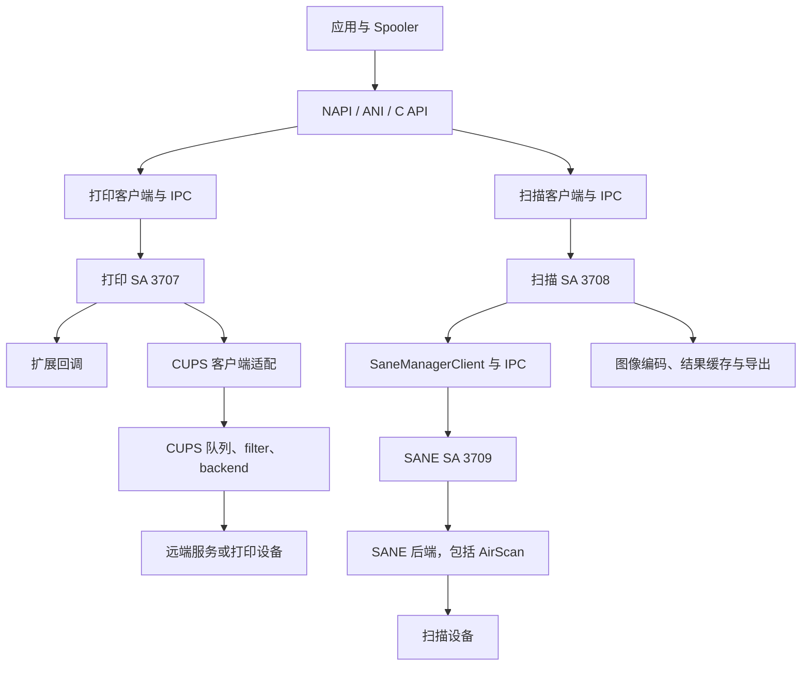

# 打印扫描架构导航

打印扫描框架连接应用接口、IPC、系统服务和协议后端。设计或定位时先确定产品构建和实际路由，再沿数据、状态和资源归属查阅专题；源码中存在某个目录或调用点，不代表目标产品已经启用该能力。

| 项目 | 说明 |
| --- | --- |
| 适用范围 | 打印／扫描模块导航和影响分析；打印细节以标准版为主，phone 差异单列 |
| 使用边界 | 提供总体分层、模块职责和协作关系；目标产品的构建、设备行为与跨仓运行结果需单独验证 |
| 更新触发 | 接口入口、IPC、SA 配置、模块职责、构建特性或依赖关系改变 |
| 维护方式 | 相关模块贡献者随变更更新；主题复核人由维护者指定，复核使用本文的链路与跨仓检查表 |

## 一、阅读入口

首次进入源码或跨仓追踪时，先按[仓库定位与代码上下文](../development/repository-context.md)区分编译树和独立检出，确认相关仓库位置及版本；下表中的源码入口相对各自已确认的仓库根目录。

| 任务 | 首先阅读 | 应得到的结果 |
| --- | --- | --- |
| 讨论需求或统一术语 | [领域对象与标识](../domain/overview.md) | 分清设备、队列、任务、会话、页和结果，列出受影响契约 |
| 理解打印任务或判断行为修改归属 | [打印任务](../workflows/print-job.md) | 创建、组件契约、生命周期、取消受理与终态、状态监听和资源收尾 |
| 扫描打开、选项、读取、关闭、重连与导出 | [扫描链路](../workflows/scan.md) | 调用者归属、执行状态、结果保留及清理顺序 |
| 产品切换或跨仓修改 | [产品与跨仓边界](variants-and-boundaries.md) | 构建条件、接口两端、证据缺口和配套变更 |
| 公开接口、权限和错误码 | [API 阅读入口](../API-DOC.md) | 官方文档版本、目标 SDK 与实现的差异；不能仅凭开发分支文档判定产品可用 |

## 二、系统分层与责任

图中上层应用和下游设备用于标明边界；Spooler UI、各类 filter 和设备执行细节由对应模块说明。eSCL 的发现和状态辅助逻辑在扫描服务内，扫描数据读取仍通过 SANE，详见[扫描链路](../workflows/scan.md)。

| 层次 | 源码入口 | 负责什么 | 不能仅据此证明什么 |
| --- | --- | --- | --- |
| 应用接口 | `interfaces/kits/napi/`、`interfaces/kits/ani/`、`frameworks/ohprint/`、`frameworks/ohscan/` | 接口绑定、参数和结果转换 | 服务和物理设备已经完成请求 |
| 打印客户端 | `frameworks/innerkitsimpl/print_impl/` | `PrintManagerClient`、`PrintServiceProxy`、回调 Stub | 服务端权限、路由与队列语义 |
| 扫描客户端 | `frameworks/innerkitsimpl/scan_impl/` | 扫描请求与回调 IPC | 后端选项含义、图像格式和设备行为 |
| 模型 | `frameworks/models/`、`utils/include/` | 参数、状态、Parcel 字段和常量 | 裸 FD 字段自动具有独占所有权 |
| 打印服务 | `services/print_service/`、`services/print_service_phone/` | 任务、设备、用户、策略、扩展与 CUPS 路由 | 两种产品实现完全相同 |
| CUPS 适配 | 所选打印服务下的 `print_cups_client.cpp` | CUPS 参数、作业提交、传输、监控与状态映射 | filter 或 backend 内部处理，以及设备输出结果 |
| 扫描服务 | `services/scan_service/` | 发现、打开归属、选项、执行、编码、进度和结果 | 每种 SANE 后端均支持某个选项 |
| SANE 服务 | `services/sane_service/`、`frameworks/ISaneBackends/` | 后端 IPC、句柄及 SANE 调用包装 | 任意设备在取消、关闭、重连时的具体响应 |

## 三、服务、线程与对象边界

| 服务或对象 | 配置与协作关系 | 修改时的关注点 |
| --- | --- | --- |
| 打印服务 | profile 中 SA 为 `3707`，进程 `print_service`，库 `libprint_service.z.so` | 不从旧说明猜测 SA 编号；产品实现由构建配置选择 |
| 扫描服务 | SA `3708`，进程 `scan_service`，库 `libscan_service.z.so` | 打开归属、后台执行和结果保留不是同一个状态 |
| SANE 服务 | SA `3709`，进程 `sane_service`，库 `libsane_service.z.so` | IPC 服务与后端库的句柄责任分别核对 |
| 服务启动配置 | 上述三个 profile 均为 `run-on-create: false` | 这是加载配置，具体何时启动、停止、卸载仍需调用链和运行证据 |
| 打印异步发送 | CUPS 发送线程持有 client 的 `shared_ptr`，发送处理返回后释放 `JobParameters`；监控另有 `JobMonitorParam` | 发送资源释放与任务状态结束不能合并为同一时刻 |
| 扫描异步执行 | `StartScan` 向 handler 投递闭包，闭包内构造栈上 `ScanTask`；执行后仍有后端收尾和延迟清理 | 请求返回、图像生成、任务收尾与 owner 释放分别核对 |

异步边界分别见[打印任务链路](../workflows/print-job.md)和[扫描链路](../workflows/scan.md)。锁、智能指针和原子状态各有保护范围，不能因为其中一项存在，就推定取消竞争或卸载过程已经安全。

## 四、从需求到源码的影响检查

| 变更主题 | 最少追踪的边界 |
| --- | --- |
| 增加参数或能力 | 接口声明／绑定 → 客户端 → Parcel → 模型 → 服务 → 实际后端；另查默认值和产品支持 |
| 改变状态或错误码 | 状态产生方 → 映射 → 服务存储／清理 → 回调 → 上层解释；主状态、子状态和协议返回分开 |
| 修改 FD、文件或回调 | 创建与接收 → 复制／借用 → 异步保留 → 成功／失败／取消清理 → IPC 与调用者 |
| 改变扫描关闭或重连 | owner 校验 → 后端句柄 → 当前执行 → 待领取队列 → 已生成缓存 → 退出／死亡清理 |
| 改变产品特性 | `print.gni` → 服务 `BUILD.gn` → 实际编译目标／宏 → 镜像服务与依赖 → 设备场景 |
| 改变跨仓契约 | 接口两端的提交、输入／输出、失败返回、资源归属、发布顺序和兼容窗口 |

需求设计先写期望行为与不变条件；问题定位先关联实际任务与时间线；代码修改先找出所有受影响分支。记录目标产品上实际执行的构建和验证结果。

## 五、源码复核方法与完成边界

1. 在具体任务中记录业务仓版本、产品、SDK、特性值和后端，核对目标实现与本文描述的差异。
2. 通过 `rg -n -F '符号名' 对应目录` 找到目标版本中的定义和调用者，按模块、接口和数据结构名称定位。
3. 记录调用发生在哪个进程／线程、同步返回表示什么、哪个回调或状态表示后续阶段。
4. 更新架构关系表和待验证项，具体版本的分析证据记录在对应任务中。涉及 API 行为时，注明核对过的官方文档版本和目标 SDK。
5. 分开报告源码检查、构建、单元测试、设备及跨仓结果；未执行项写明环境与证据缺口。

本文及其专题没有完成全部生命周期或安全审计。标注的源码边界用于指导后续追踪，不能解释为所有异常、并发或产品组合已验证通过。
