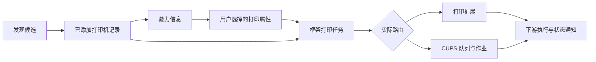

# 打印扫描领域对象与术语

先区分设备、队列、任务、结果和调用者，再讨论它们的状态与生命周期。“发现了打印机”“任务提交成功”“扫描结束”都只表达一个阶段，不能代替后续阶段的完成结论。

| 项目 | 说明 |
| --- | --- |
| 适用范围 | 打印扫描需求讨论、问题定界和修改影响分析；具体实现差异见[产品与跨仓边界](../architecture/variants-and-boundaries.md) |
| 文档边界 | 定义领域术语、对象关系和身份边界；使用数据结构名称对照概念，具体实现映射见架构文档 |
| 知识状态 | 术语为本文统一表述；不据此承诺某个产品或版本已经支持相关能力 |
| 复核触发 | 对象含义、标识作用域、对外数据契约、状态语义或资源归属改变 |
| 维护与验收 | 相关模块贡献者更新，主题复核人由维护者指定；用本文末尾的场景检查理解是否一致 |

## 一、打印领域

| 术语 | 本文含义 | 不应混用的概念 |
| --- | --- | --- |
| 物理打印机 | 实际执行打印的设备 | 服务中的设备记录、某个 CUPS 队列 |
| 已发现打印机 | 某种发现方式当前提供的设备候选 | 已完成添加、已连接、所有能力可用 |
| 已添加打印机 | 框架管理的已添加设备记录 | 永久在线或当前可打印 |
| 打印能力 | 设备或驱动声明支持的纸张、分辨率、颜色等选项 | 某次任务实际选择的参数 |
| 打印属性 | 一次打印请求选择的份数、纸张、方向等设置 | 设备所有支持能力的集合 |
| 打印队列 | 接收和调度作业的逻辑目标；讨论时注明“框架队列”或“某台 CUPS 的队列” | 物理设备本身、界面中的列表 |
| 打印任务 | 框架接受并跟踪的一次打印工作 | 一页、一个文件、一个下游服务中的作业编号 |
| CUPS 作业 | 某个 CUPS 实例管理的作业 | 框架 `PrintJob`；远端 CUPS 的同名或同号作业 |
| 打印扩展 | 通过扩展回调承接发现或打印等操作的实现 | 所有驱动、CUPS filter、扫描后端的统称 |
| 打印完成 | 必须注明完成的层次：文件准备、提交、传输、下游报告完成或设备实际输出 | 单独一个“成功”返回值 |

相关数据结构：`PrinterInfo` 表达打印机信息，`PrinterCapability` 表达打印能力，`PrintJob` 表达打印任务。讨论需求时应明确这些对象之间的关系，以及标识、参数、状态和文件资源各自属于哪个对象。

这是阅读关系图，不代表所有入口必须经过交互式添加，也不表示每次请求都会创建新的物理设备。路由判定见[打印任务链路](../workflows/print-job.md)。

## 二、扫描领域

| 术语 | 本文含义 | 不应混用的概念 |
| --- | --- | --- |
| 扫描设备 | 可通过某种后端访问的扫描目标 | 当前应用持有的打开权限 |
| 扫描连接 | 从成功打开设备到关闭或清理的使用关系 | 一次扫描执行、扫描结果的全部保留时间 |
| 扫描调用者 | 发起 IPC 操作的进程及其用户身份 | 应用显示名称，或长期不变的应用标识 |
| 扫描会话 | 同一调用者使用扫描服务期间的业务关系 | 某个具体类或公开 sessionId；使用这一术语不代表接口提供独立会话对象 |
| 扫描任务 | 一次启动后执行读取与图像处理的工作；批量模式可以产生多页 | 一个设备 ID、单页编号 |
| 扫描页 | 任务中的一份页面结果 | 后端传输的数据帧；一页可以由多个数据帧组成 |
| 扫描结果 | 生成并可领取或再次导出的图像及其关联缓存 | 当前设备仍然打开、待领取队列中的元素 |
| 原始数据 | 供后续图像处理使用的像素数据 | JPEG、PNG、TIFF 编码文件；两者格式和生命周期不同 |
| 最后一页标记 | 扫描进度中的 `isFinal`，表达这次结果序列是否结束 | 当前进度百分比，或整个服务已经退出 |

相关数据结构：`ScanDeviceInfo` 表达扫描设备信息，`ScanProgress` 表达扫描进度与结果领取信息。扫描连接、任务和结果是需要分别讨论的领域对象，其生命周期不应仅由一个进度值代表。具体协作关系见[扫描链路](../workflows/scan.md)。

## 三、标识、作用域与归属

### 3.1 打印标识

| 标识 | 含义与作用域 | 定位时怎样记录 |
| --- | --- | --- |
| 打印机标识（`PrinterInfo`） | 在所属框架或后端的标识空间中定位打印机记录；不同标识空间之间需要明确映射 | 同时记录发现方式和实际 URI，不能只凭显示名称关联 |
| `printerName` | 打印机显示名称与 CUPS 队列名称属于不同上下文，不能默认等同 | 写明名称所在层次，以及目标 CUPS 实例 |
| `printerUri` | 说明访问或路由目标；并不替代框架记录的身份 | 记录协议、目标端点和所处层次，输出证据时脱敏 |
| 框架 `jobId` | 标识 `PrintJob` 所表达的任务；其作用域不能自动扩展到其他打印系统 | 连同所属服务和用户记录，不把同名字段当作跨系统唯一标识 |
| CUPS `job-id` | 标识目标 CUPS 实例中的作业；与框架任务之间需要维护关联关系 | 记录“CUPS 实例＋job-id＋框架 jobId”；代理或共享拓扑逐跳关联 |
| `ownerPid` | 服务用于回调及任务归属处理的调用者进程信息 | 同时核对用户和任务，不把 PID 当作永久应用身份 |

设计新增映射时，应明确标识的产生方、使用方、作用域和失效条件。调用方按约定传递标识，不应从字符串格式推断其内部组成；具体映射关系见[打印任务链路](../workflows/print-job.md)。

### 3.2 扫描标识

| 标识或归属信息 | 领域含义 | 适用限制 |
| --- | --- | --- |
| 扫描设备标识（`ScanDeviceInfo`）／接口参数 `scannerId` | 定位后端可访问的扫描目标 | 可以包含后端和端点信息；重连后不能未经核对视为稳定硬件身份 |
| `uniqueId`、`serialNumber`、`discoverMode` | 分别表达设备标识、序列号和发现方式等信息 | 不是别名；不能仅凭字段名称把发现标识当作硬件序列号 |
| 扫描连接归属 | 明确哪个调用者、在哪个用户上下文中使用哪个扫描设备 | 设备使用权与任务、结果的归属分别确认；多设备并发能力由产品和接口契约约定 |
| 扫描页标识 | 在任务或结果集合内区分页面，并关联其处理与领取状态 | 服务内部编号不自动成为对外句柄；对外暴露及有效期需要单独约定 |
| 扫描结果关联 | 将同一页面的原始数据、元数据和不同格式的图像关联起来 | 业务关系不依赖缓存文件的命名和存放方式，调用者不应自行拼接缓存路径 |
| 图片 FD | 当前进程中访问图像的描述符 | 不是稳定结果 ID；不能跨进程比较整数来证明是同一个文件 |
| 扫描结果归属 | 明确结果由谁领取、导出以及触发清理 | 调用者身份与结果有效期应分别约定，不由缓存容器的组织方式推导权限 |

设备信息与进度结果分别参照 `ScanDeviceInfo` 和 `ScanProgress`。接口实际暴露哪些字段、结果怎样交接及何时失效，见[扫描链路](../workflows/scan.md)与[API 入口](../api/README.md)。

## 四、状态、结果和资源应分别讨论

| 容易混淆的说法 | 讨论时需要补充的信息 |
| --- | --- |
| “打印完成了” | 哪一层报告、哪个任务、主状态和子状态、是否有设备输出证据 |
| “打印机离线” | 发现记录消失、连接失败、队列暂停、backend 报告或设备状态中的哪一种 |
| “关闭扫描” | 停止当前读取、关闭后端句柄、清空待领取队列、回收结果还是卸载服务 |
| “扫描就绪” | 执行状态是否允许启动，以及设备是否打开、由谁占用，需要分别确认 |
| “结果还在” | 缓存路径存在、服务 FD 有效、调用者 FD 有效、可再次导出是四项不同检查 |
| “任务取消成功” | 取消请求被接受、执行停止、后台收尾结束、回调送达与资源释放分别何时发生 |

资源讨论统一使用“借用、复制出独立描述符、转移关闭责任、关闭并使持有状态失效”等明确表述。C++ 对象复制、复制一个 FD 整数、`dup` 和 IPC 传递不应都写成“复制资源”。实际清理链路见[打印所有权](../workflows/print-job.md#六文件回调与任务收尾)与[扫描结果交接](../workflows/scan.md#四结果缓存与-fd-交接)。

## 五、把术语用于设计与定位

| 场景 | 需要明确的对象与边界 | 继续阅读 |
| --- | --- | --- |
| 增加一种纸张或颜色选项 | 能力来源、任务选择值、跨层编码、后端接受值、默认值与版本 | [打印链路](../workflows/print-job.md)、[API 入口](../api/README.md) |
| 提交成功但没有出纸 | 框架任务、实际路由、每级 CUPS 作业和设备结果 | [提交与执行](../workflows/print-job.md#二创建提交与异步执行) |
| 关闭再打开后继续领取结果 | 连接归属、待领取队列、已生成缓存、调用者身份和导出权限 | [扫描生命周期](../workflows/scan.md#三状态与生命周期) |
| 修改 FD 清理 | 哪个对象持有整数、哪次操作建立独立 FD、哪个分支负责关闭 | 两篇链路文档中的所有权表 |
| 支持一个新产品或后端 | 构建分支、服务实现、运行时路由、依赖仓与设备能力 | [产品与跨仓边界](../architecture/variants-and-boundaries.md) |

验收本文时，用一个打印任务和一个批量扫描任务回答：有哪些不同标识、各自由谁持有、哪些状态可独立变化、结果在哪个阶段仍应可用。回答不清的部分回到源码和产品需求核对，避免用同一个“任务结束”覆盖所有清理时机。
