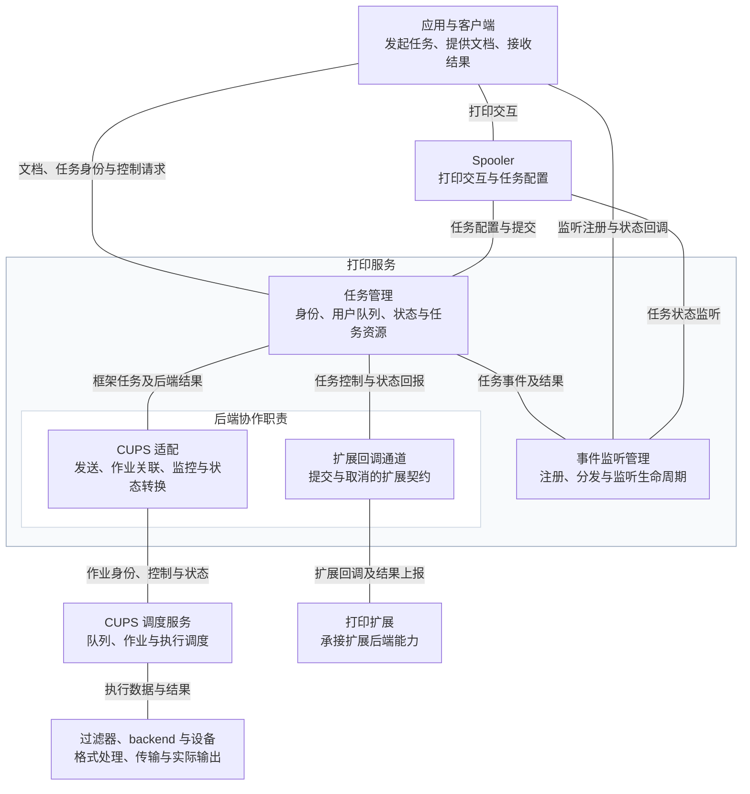
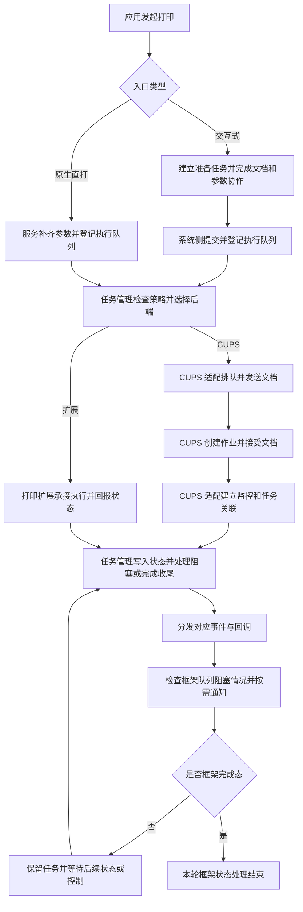
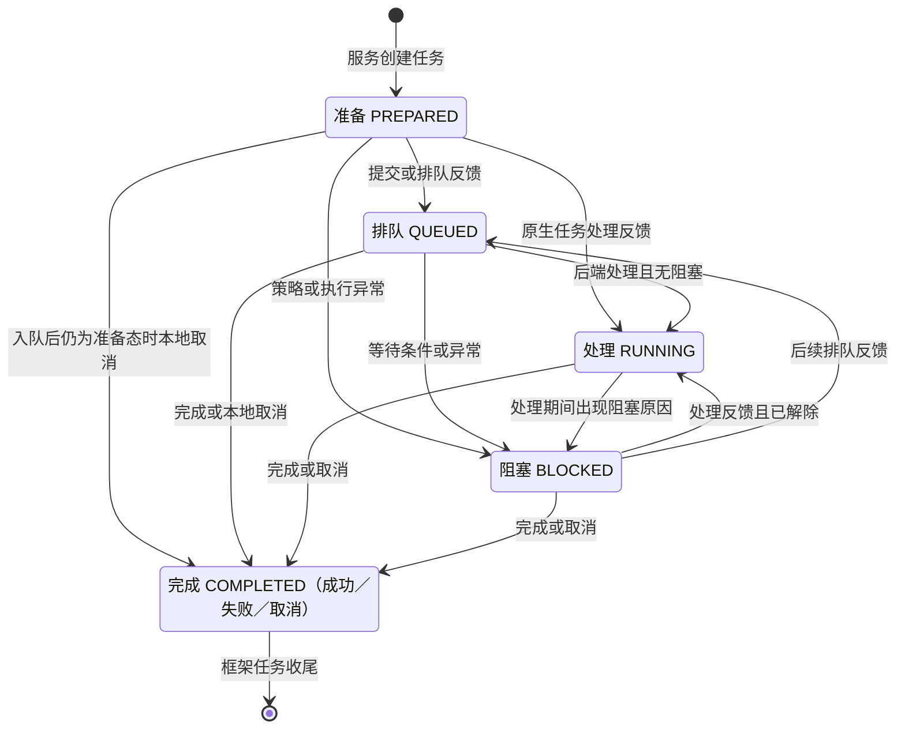

# 打印任务

打印任务连接应用的打印意图、文档准备、服务调度和后端执行。打印服务持有框架任务及其用户关系，后端适配负责把任务转成可执行作业，再把执行结果带回服务。调用返回、框架终态、后端作业结束和设备实际输出是四种不同事实。

本文以标准版 `print_service` 为范围，覆盖交互式打印、原生直打、CUPS 路由及打印扩展协作。phone 是独立服务实现，不据同名接口推定行为一致；构建开关和后端适用条件见[产品与跨仓边界](../architecture/variants-and-boundaries.md)。术语见[领域说明](../domain/overview.md)，实现定位统一从[仓库与组件导航](../development/repository-context.md)进入，接口可用范围见[API 入口](../API-DOC.md)。

## 一、组件架构与职责

图按职责归属组织；连线表达长期协作契约，不表示调用顺序。打印服务内的分组是逻辑职责，不是新增进程。

| 组件 | 拥有的职责 | 必须保持的边界 |
| --- | --- | --- |
| 应用与客户端 | 提供文件或文档适配器、打印属性，建立任务请求及监听；客户端和 IPC 传递参数与回调 | 客户端生成或携带框架任务标识，不承担 CUPS 作业管理；普通应用和系统管理接口权限不同 |
| Spooler | 交互式路径中的配置、预览与提交协作 | 界面关闭、文件生成结束和打印任务结束各有语义；本文不规定其界面文案 |
| 任务管理（`PrintServiceAbility`、用户数据） | 创建服务侧任务记录，关联用户、ownerPid、打印机及文件，选路并维护框架主／子状态和队列 | 服务管理框架任务；不能把后端编号当作框架 jobId，或把当前活动用户当作所有异步任务的所属用户 |
| 事件监听管理（`EventListenerMgr`） | 管理按用户、进程、事件类型及任务组织的监听，分发服务生成的回调 | 状态由任务管理和状态生产方决定；监听器不是后端状态机，也不是持久事件日志 |
| CUPS 适配（`PrintCupsClient`） | 维护发送参数、发送队列、当前发送、作业 ID 关联与监控；转换取消意图和后端状态 | 发送队列管理文档提交，不是按物理出纸完成串行调度的队列 |
| 扩展回调通道与打印扩展 | 服务向扩展分发提交／取消回调，扩展承接自己的执行并通过状态更新入口回报 | 回调分发结果不等于设备结果；不能套用 CUPS 的监控模型 |
| CUPS 调度服务及下游 | CUPS 管理自身作业，调度过滤器和 backend；下游处理数据、传输与输出 | CUPS 作业终态属于该实例的状态；远端队列和物理设备可能还有各自的生命周期 |

## 二、创建、提交与异步执行

### 创建与持有

交互式路径由应用／客户端发起并携带任务标识，服务建立 `PrintJob`，记录文件描述符和 ownerPid，以 `PREPARED` 放入准备任务集合并发出任务事件。文件准备、配置和预览属于这一业务阶段；`PREPARED` 本身只表示初始任务状态，不保证文档已经完整可打印。系统侧提交时，服务校验任务，构造执行记录、继承 ownerPid，设为 `QUEUED` 并登记用户队列，再进行后端路由。

原生直打由服务采用传入 jobId 或生成新 ID，补齐打印机参数，创建 `PREPARED` 任务，将 ownerPid 设置为本次 IPC 调用进程，按服务取得的当前用户登记用户队列后提交。当前这条创建前缀没有与交互式提交相同的显式 `QUEUED` 赋值；因此不能要求每个消费者都依次收到 PREPARED、QUEUED、RUNNING。准备记录、执行队列和后端作业也不是三个不同的业务任务。

交互式入口及按任务监听参数中的 taskId，在本文所述链路中用于同一个框架任务标识，对应 `PrintJob.jobId`；它不是另一个 CUPS 作业号。

服务同时维护任务索引和用户数据。调用者持有的任务标识用于控制与关联，不代表持有服务对象；`ownerPid` 用于回调等归属处理，不能替代用户身份。CUPS 适配另外维护框架 jobId 与本地 CUPS job-id 的关联；排查共享或远程打印时，必须逐实例关联作业，不能直接比较编号。

### 业务流程

下图描述职责之间的业务推进，区别于前面的组件关系图。错误可在各阶段发生；具体表现可能是调用失败、阻塞或完成失败，不统一画成一个“失败出口”。

CUPS 路由先建立发送参数并排队，发送线程创建 CUPS 作业并逐个传送文档，成功后建立监控连接和 ID 关联。发送处理返回后，适配释放当前发送参数并开始下一个发送，已有作业仍可继续被监控。建参数、发送或建立监控失败可中断这条链，不能由提交接口成功推断文档已传完或监控已建立。

选路当前为 ePrint、以及启用远程服务时的远程打印机走扩展，其余进入 CUPS。启用 Agent 时有准备和保活协作，但没有把后续提交替换成另一条通用路由。改后端时应同时核对提交和取消的选择条件，不能仅按打印机名字推断执行方。

## 三、状态与生命周期

### 业务概念、框架状态和后端状态

下表中的常量采用框架内部名称。应用绑定可能使用不同导出名称，例如 NAPI 将初始状态导出为 `PRINT_JOB_PREPARE`；应按所用接口核对，不能把内部表直接当成所有 SDK 的枚举声明。

| 业务表达 | 框架表达 | 产生条件与含义 |
| --- | --- | --- |
| 准备中 | `PRINT_JOB_PREPARED` | 服务创建初始任务；文档、配置或交互仍可能未完成，尚不能证明已创建下游作业 |
| 排队中 | `PRINT_JOB_QUEUED` | 交互式提交入队，或适配报告等待发送／后端排队；需要分清框架队列、发送队列与 CUPS 队列 |
| 打印中／处理中 | `PRINT_JOB_RUNNING` | CUPS PROCESSING 且未判定阻塞时映射；上传、转换等子状态也属于处理阶段，不保证设备此刻正在出纸 |
| 阻塞 | `PRINT_JOB_BLOCKED` 加原因子状态 | 离线、认证、缺纸、策略限制等条件；服务保留任务并登记历史，后续可收到排队、运行或终态，不能当作已完成 |
| 取消中 | 没有独立主状态 | 业务控制过程；CUPS 适配用发送／监控对象中的取消标记表达意图。原主状态可能暂时不变；不应虚构 `CANCELING` 枚举 |
| 已取消 | `PRINT_JOB_COMPLETED` ＋ `PRINT_JOB_COMPLETED_CANCELLED` | 框架取消终态，来源包括适配本地收尾、后端取消状态及兜底路径；不等同于设备停机确认 |
| 成功完成 | `PRINT_JOB_COMPLETED` ＋ `PRINT_JOB_COMPLETED_SUCCESS` | CUPS COMPLETED 等结果回报；只代表当前执行链的完成报告 |
| 完成失败 | `PRINT_JOB_COMPLETED` ＋ `PRINT_JOB_COMPLETED_FAILED` | 明确走完成失败分支，例如监控时 IPP-over-USB 设备断开；不是所有错误都会进入该终态 |

`COMPLETED_FILE_CORRUPT` 也是完成类子状态，但不能从常量名字推断每个文件错误路径都成功写入该状态。`BLOCKED_CANCELLED` 属于阻塞子状态，不等于完成取消，也不是“取消中”的统一表示。`UNKNOWN` 是框架保留主状态；`CREATE_FILE_COMPLETED` 和 `SPOOLER_CLOSED` 是内部文件生成／交互结束信号，不属于设备执行完成，前者走独立文件回调。

### 状态视图

图只呈现已核对路径的业务归纳，不是服务强制实施的完整状态转移约束。服务对主／子状态做数值检查后更新记录，并没有按旧状态逐项限制所有边。初始通知和中间状态可能因入口、后端或监听时机而不同。

图中终点指本轮框架任务处理结束，不是所有后台对象的退出屏障。状态更新需要通过服务校验并成功找到记录，后端调用更新入口不等于状态一定写入；完成主状态只接受完成类子状态范围，阻塞主状态也有子状态下界检查。取消意图不单独画成状态节点，因为它可覆盖排队、发送和监控阶段；准备页退出也不能机械套用执行队列取消路径。

### CUPS 到框架的转换

| CUPS 状态／条件 | 适配结果 | 对生命周期的影响 |
| --- | --- | --- |
| `IPP_JOB_PENDING` | 通常 QUEUED；特定停止／保持原因转 BLOCKED | 仍等待后续查询 |
| `IPP_JOB_HELD` | SMB 连接或认证原因转对应 BLOCKED，否则按排队处理 | 保持原因决定含义，HELD 不能统一解释为暂停打印 |
| `IPP_JOB_PROCESSING` | 有阻塞原因则 BLOCKED，否则 RUNNING；取消标记已设时暂不更新这两个状态 | 同一个 CUPS 主状态可能对应不同框架状态 |
| `IPP_JOB_COMPLETED` | COMPLETED／SUCCESS | 结束该监控；与取消请求竞争时仍可能回报成功 |
| `IPP_JOB_CANCELED` | 当前经默认分支转 COMPLETED／CANCELLED | 默认分支也接收其他未单列状态，不可把它视为严格的取消确认校验 |
| `IPP_JOB_ABORTED` | 未请求取消时转 BLOCKED／UNKNOWN；已设取消标记时不再更新状态 | 两种情况均结束这次监控，因此“阻塞”不保证一定还有监控自动恢复 |
| `IPP_JOB_STOPPED` | 尝试取消；请求成功继续监控，失败尝试以拼接子状态回写 COMPLETED 后结束监控 | 已有原因与取消码拼接后可能不符合完成态校验，回写会被拒绝；不能保证产生取消终态 |
| 连接／设备离线 | 普通路径报告 BLOCKED／OFFLINE 并继续；IPP-over-USB 断开走完成失败 | 后端和连接条件决定是否终结 |

例如缺纸后监控继续，后续查询无阻塞可重新报告 RUNNING；而 ABORTED 映射为 BLOCKED 后监控结束，不能仅靠等待推定会恢复。重试／重启应按具体后端和任务重新提交路径处理，不能只把状态改回 RUNNING。已请求取消后若查询到 ABORTED，当前分支结束监控而不回写终态，不能据这条路径认定框架一定会完成取消；处理停留任务需要联查适配反馈与服务记录。

## 四、取消控制与终态

取消请求首先经过服务端权限与任务查找，再决定本地收尾或交给后端。当前入口从当前用户的执行队列或历史记录取任务，不是任意准备任务的通用撤销入口。准备页面退出的内部事件应与执行任务取消区分。服务还按当前主状态决定是否交给后端：已找到的任务若仍是 PREPARED，走服务本地完成取消；当前分支按主状态数值是否大于等于 QUEUED 判断是否进入后端取消；这是实现判断，不是证明文档已发送或设备开始执行的业务检查。原生任务已入队、甚至开始发送后仍可能暂为 PREPARED，因此“正在发送”不能单独决定取消路由。

| 取消时任务位置 | 当前承担者及行为 | 何时可解释为框架已取消 |
| --- | --- | --- |
| 已在用户执行队列、主状态仍为 PREPARED | 服务直接尝试回写完成取消，不调用 CUPS 适配取消 | 服务接受更新后；该分支不设置发送／监控取消标记，不能证明后端停止 |
| CUPS 适配待发送队列（服务已进入后端取消分支） | 适配删除参数和队列项，回写完成取消 | 该状态被服务接受并更新后 |
| 当前发送，监控尚未登记（已进入后端取消分支） | 适配设置发送取消标记；找不到监控时直接回写完成取消 | 框架可能先达到终态；发送线程不因此被同步等待退出 |
| 已登记监控（已进入后端取消分支） | 设置监控取消标记，由监控发起下游取消并处理结果 | 收到取消映射或走兜底完成取消；PROCESSING 时可能继续等待，COMPLETED 仍可映射成功 |
| 扩展任务（已进入后端取消分支） | 分发取消回调，执行结果由扩展协作上报；缺监听者或分发失败的部分路径会回写完成取消 | 以服务实际接受的主／子状态为准；分发成功本身不是取消终态 |

服务 CUPS 取消分支调用的是无返回值的适配操作，随后返回成功。这个返回只能说明服务走完本次请求处理，不能证明 CUPS 接受了 Cancel-Job。扩展缺监听者路径还可能一边回写完成取消、一边返回服务失败；调用结果和任务结果必须分别消费。这里的失败指服务方法结果；客户端还经过 IPC 错误转换，不能假定它收到相同错误码。改变调用结果契约时应联查客户端、IPC 和服务。

CUPS 调度服务收到有效 Cancel-Job 后设置自己的 CANCELED 状态并处理调度；已经终结的作业可能返回不可取消。框架监控的取消请求失败时，当前实现仍可能直接回写完成取消并停止监控。因此“已取消”是框架收尾结论，不能用来承诺设备立即停止或已输出页面可撤回。

发送与监控各持有取消标记，发送前检查并不能证明整个传输循环都响应取消；发送到监控的交接也不能仅凭两个同名标记推定已经可靠传递。降低取消延迟或修复取消竞争，应由 CUPS 适配核对阶段交接、任务 ID、最后使用者和终态回报，而不是增加一个界面状态掩盖这些边界。

## 五、状态产生、更新与监听

状态生产方包括服务本身（创建、提交、策略等）、CUPS 适配（查询和转换）及扩展状态上报方。服务状态入口先按 jobId 找用户及执行队列记录；不在执行队列时，历史查询仍走当前用户口径。成功找到记录并写入主／子状态后，先处理阻塞或完成，再分发任务事件、文档适配器回调，最后检查框架队列是否进入或解除阻塞。完成处理中的“推进”是服务尝试选择后续框架任务并分发扩展提交回调，受任务状态、选路和监听条件约束，不保证下一任务已执行；通知后的“检查”是队列阻塞汇总。两者都不同于 CUPS 适配在发送结束时启动下一发送。文件生成结束走独立回调，不沿普通执行状态更新链。

对仍在执行队列中的任务，服务在发出完成事件前已经执行关闭任务 FD、删除缓存和移除队列记录的处理；这说明调用顺序，不保证每个清理操作成功。通知携带保留的任务对象／副本，不能依赖完成回调到达后仍能从执行队列或历史查询同一记录。迟到状态可能因记录已移除而失败；这里没有全局终态唯一、任意迟到更新都被禁止或资源全部退出的保证。

| 通道 | 注册和接收内容 | 消费约束 |
| --- | --- | --- |
| `jobStateChange` | 服务端按管理类事件注册，需 PRINT_JOB 权限；发送任务模型副本，其中 FD 列表被清空 | 可用于任务总体状态观察；不能把它当作所有普通应用都可订阅的公共通道 |
| 按任务注册的结果事件 | 按 taskId 注册；BLOCKED 对应 block，完成成功／失败／取消分别对应 success／fail／cancel | 是选定结果事件，不会覆盖所有准备、排队和处理变化 |
| 内部任务状态回调 | 对识别出的阻塞及上述完成结果进行任务回调；完成回调分发调用返回后，安排移除该任务的内部状态监听 | 不能假定每次主／子状态更新都会触发，也不能用它恢复完整历史 |
| 文档适配器回调 | 匹配任务 ID，并对无任务管理权限的监听者校验 ownerPid；处理 BLOCKED、COMPLETED、SPOOLER_CLOSED 并转换为适配器状态 | 适配器状态另有语义；没有把所有框架状态原样广播 |
| 文件生成回调 | 传递文件创建成功／失败结果 | 文件就绪不能替代打印成功事件 |

任务结果和任务状态回调通过异步 IPC 发出；分发调用返回不表示应用已处理，延迟注销也不是回调处理完成或后台退出屏障。内部状态监听仅清除对应任务的该类监听；文档适配器在存在对应监听并完成分发调用后，对 COMPLETED 或 Spooler 因取消关闭的通知安排移除该任务的适配器监听；不能把一种通道的注销扩大到所有监听。

监听通过注册／注销和回调对象生命周期管理，不是状态历史回放。调用者应按自己可用的接口区分即时调用结果、任务事件和查询结果，并按任务身份关联；注册成功不保证补发此前的每个状态。

用户归属是关键契约，但当前实现的查找口径并不完全统一：状态更新先按 jobId 找用户，但历史回退查询按当前用户；取消也按当前用户查找，部分事件同样取当前用户；事件管理在目标用户不命中时还有遍历其他用户监听的分支，最终匹配由具体回调处理：任务类回调匹配 jobId，对没有任务管理权限的监听者还要求 PID 等于 ownerPid；管理类 jobStateChange 回调不采用这项逐任务 PID 过滤。不能把这些路径概括成“所有通知始终只路由给任务所属用户”。修改用户切换或后台通知时需联查这些边界。

## 六、文件、回调与任务收尾

| 持有方 | 所持对象 | 收尾责任与边界 |
| --- | --- | --- |
| 服务任务管理 | 任务侧 FD、缓存文件、用户队列及历史记录 | 完成处理对仍在执行队列的任务关闭 FD、删缓存、移除队列，并清理历史、尝试推进后续框架任务；阻塞处理登记历史，不做同样的完成清理 |
| CUPS 发送参数 | 发送所需 FD、选项、取消标记 | 发送处理返回后释放参数并启动下一个发送；该时刻不代表设备完成 |
| CUPS 文件包装 | 被交给文件读取接口的 FD | 文件关闭后参数列表对应项失效，避免后续再次按原整数关闭 |
| CUPS 监控对象 | CUPS 作业身份、监控连接和取消／中断标记 | 独立于发送参数存活，监控结束和最后引用释放需分别确认 |
| 扩展闭包与监听管理 | 任务共享引用、回调信息、监听对象 | 任务对象仍在不证明服务和外部资源仍可使用；注销和迟到回调需配合处理 |

模型保存 FD 整数，复制 `PrintJob` 或设置 FD 列表不自动建立独立描述符，模型析构也不负责关闭这些 FD。CUPS 参数正常通过 dup 取得描述符，但当前 dup 失败会回填原 FD，故不能宣称所有异常路径仍完全独立持有。修改清理必须核对创建、复制、移交、最后使用和关闭，而不是从“完成态”推出后台资源已全部释放。

## 七、设计解读与变化归属

以下是从源码职责归纳的架构解读，不是原始设计动机记录，也不表示所有当前路径都已满足这些原则。

**统一任务概念，集中承担后端差异。** 应用希望控制一次打印工作，CUPS 和扩展却有不同作业与控制方式。服务保留框架身份和状态，适配负责转换，使发送策略或后端协议可以变化。代价是适配必须维护关联和状态含义，不能仅透传后端编号或成功返回值。

**控制与结果分开，保留异步执行空间。** 文件发送、调度、设备处理无法由一次接口调用同步完成。请求通道传意图，状态通道报告阶段和结果，允许发送与监控独立调整；相应地，取消意图必须跨阶段可识别，消费者也不能把返回成功当作执行终态。

**任务生命周期与资源生命周期分别管理。** 框架终态支持用户任务收尾，后台对象则由实际使用者结束。允许改线程和缓存策略，但必须保留用户归属、迟到反馈处理和最后使用者的清理责任。阻塞仍保留任务，恢复策略要结合监控是否继续，而不是仅依赖主状态名称。

| 需求变化 | 主要负责组件 | 必须联动或保持的契约 |
| --- | --- | --- |
| 调整创建、预览或原生提交 | 应用／客户端、Spooler、任务管理 | 同一任务身份、文件准备与执行的边界、ownerPid 和用户关系 |
| 调整路由或接入新后端 | 任务管理、后端适配或扩展 | 提交与取消的后端一致性、作业关联、状态回报及构建范围 |
| 调整发送或取消响应 | 服务的状态分支、CUPS 适配及必要的 CUPS 调度／backend；扩展任务联动扩展回调与实现 | 取消意图跨阶段延续、调用结果与终态分离、资源最后使用者 |
| 调整阻塞、恢复、失败判定 | 状态生产方、适配转换与服务状态管理 | 主／子状态组合、监控是否继续、队列保留与终态清理 |
| 调整通知或界面展示 | 服务事件、监听管理及对应消费者 | 通道权限、事件覆盖范围、注销时机；不能从界面文案倒推出枚举 |
| 调整用户切换或资源回收 | 服务用户／任务管理及后台执行方 | 异步身份关联、FD 别名、迟到回调和执行退出边界 |

组件职责、入口、状态映射、通知范围或资源契约变化时更新本专题；目录重构优先更新[统一导航](../development/repository-context.md)，无需在正文维护逐函数路径。
