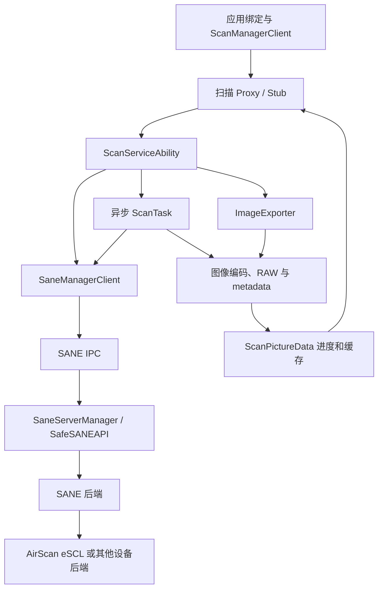

# 扫描会话、执行与结果链路

扫描服务中的设备打开、任务执行、页面生成、结果领取和缓存清理是不同阶段。关闭设备会清理待领取队列，但不会直接删除所有结果缓存；结果保留也不代表关闭设备后所有结果接口仍可调用，因为进度和导出入口还检查当前打开归属。

| 项目 | 说明 |
| --- | --- |
| 适用范围 | `scan_service`、`sane_service` 及模型／IPC；设备和后端实现另查对应仓库 |
| 当前约束 | 服务保存一个 `openedScanner_` 和一个执行状态；本文不定义多设备并发的新模型 |
| 使用边界 | 说明扫描生命周期与结果交接；设备能力、导出行为和并发场景需结合目标产品验证 |
| 更新触发 | 打开归属、选项、读取、页完成、取消、结果 FD、缓存、死亡清理或卸载变化；贡献者更新，复核人由维护者指定 |

术语与标识见[领域说明](../domain/overview.md)，跨仓和产品条件见[边界说明](../architecture/variants-and-boundaries.md)。

## 一、分层与真实数据路径

`SaneManagerClient::SaneOpen`、`SaneRead` 等通过代理调用 SANE 服务；`SaneServerManager` 查找句柄，再由 `SafeSANEAPI` 包装 `sane_open/start/read/cancel/close`。

eSCL 设备的 `deviceId` 由 `EsclDriverManager` 生成 `airscan:eSCL:scanner:http://.../eSCL/` 形式，初始化会准备 AirScan 后端链接和配置。发现或 ADF 状态的辅助处理不意味着图像读取绕过 SANE；图像读取沿上述公共调用链执行。后端存在不代表目标镜像已安装或实际设备已匹配。

## 二、从打开到页面结果

| 阶段 | 当前实现与证据 | 返回或完成的含义 |
| --- | --- | --- |
| 初始化 | `InitScan` 检查权限并 `ManualStart`；服务初始化调用 SANE、USB、系统资料与 eSCL 初始化 | 不代表已经打开设备 |
| 打开 | `OpenScanner` 在 `lock_` 下检查非空 ID；同 scannerId、PID、userId 的重复打开返回成功，其他已有打开记录返回 BUSY；后端成功后登记三元组 | 建立当前打开归属，不代表已启动采集 |
| 选项与参数 | `OpScanOptionValue` 处理 GET／SET／AUTO；`GetScanParametersInternal` 获取实际图像参数 | 区分 UI 意图、后端接受值和框架软件处理；不要只按显示的“黑白”推断位深 |
| 启动 | `StartScan` 核对 owner、READY、ADF，调用后端 start；设置 `SCANNER_SCANING`、登记页进度、投递闭包 | 返回不表示图像已写完；handler 缺失还会返回服务失败，需要检查前面已发生的状态变化 |
| 执行 | 闭包构造 `ScanTask(scannerId, userId, batchMode, callerPid)`；单页／批量生成调用 `DoScanTask` | 任务对象的作用域在异步闭包中，不在最初 IPC 调用栈中 |
| 读取与编码 | 取得参数、写图像头、读取 frame；正常结束调用 `ImageFinishCompress`，JPEG 路径还保存 RAW 和 metadata | 后端 EOF、图像封装结果和结果进度应分别核对 |
| 页完成 | 单页正常 EOF 后置进度 100 和 isFinal；批量通过下一次 start 的结果更新当前／后续页面 | 一页 100 不等于整个批量过程或服务已经结束 |
| 结果领取 | `GetScanProgress` 检查当前 owner，再取队首页；页完成时打开 JPEG，登记缓存 FD 并弹出待领取队列 | 当前是消费式领取，不是按内部 pictureId 任意重取 |
| 收尾 | `StartScanTask` 尾部取消、关闭、重开后端，清除颜色设置，恢复 READY，并消费符合条件的延迟 owner 清理 | 此后端重开是当前实现的一部分，不表示用户显式发起了新的连接请求 |

## 三、状态与生命周期

### 3.1 两种相互关联但不同的状态

`openedScanner_` 记录是否打开以及 `scannerId + callerPid + userId`。`scannerState_` 只有 `SCANNER_READY`、`SCANNER_SCANING`、`SCANNER_CANCELING`；它表达执行状态，不包含“未打开”这一状态。枚举中的 `SCANING` 按源码原拼写保留。

| 触发点 | 执行状态变化 | 打开记录与结果变化 |
| --- | --- | --- |
| 成功打开设备 | 不以打开操作直接启动扫描 | 登记 owner；已有其他打开记录时拒绝 |
| 成功通过启动前检查及后端 start | READY → SCANING | 登记进度并安排后台执行；失败收尾需按具体返回点追踪 |
| 扫描中的取消成功 | SCANING → CANCELING | 清理待领取队列；普通取消不主动清除 `openedScanner_` 或全部缓存 |
| 扫描中关闭设备 | SCANING → CANCELING | 清理待领取队列，调用后端关闭；成功才清除打开记录与对应颜色设置 |
| 后台任务到达收尾 | → READY | 当前代码做后端 cancel/close/open；如处于取消中再次清队列，并处理延迟 owner 清理 |
| 服务整体清理 | → READY | 重置打开记录、退出 SANE、停止发现、清除缓存和监听资料 |

本表描述各入口的赋值和操作，不证明所有并发交错都满足理想状态机。特别是关闭后允许打开、旧任务仍在收尾、后端重新打开之间的关系，需要结合设备句柄与任务归属验证。

### 3.2 关闭、取消、退出和死亡不是同一种清理

| 操作 | 当前路径 | 保留或限制 |
| --- | --- | --- |
| `CancelScan` | owner 校验 → 清队列 → `SaneCancel`；成功且原为 SCANING 才置 CANCELING | 不等于设备关闭或结果全清；后端取消失败时前面的清队列已发生 |
| `CloseScanner` | owner 校验 → 清队列 → 必要时 cancel → `SaneClose` → 成功后重置打开记录 | 保留缓存容器中的结果；close 失败时打开记录仍在 |
| `ExitScan` | 若调用者持有打开记录，执行关闭；仍在运行则登记 `pendingCleanOwner_`；未延期时 `CleanByOwner` | 普通退出面向调用者；不等于立即卸载整个服务 |
| `CleanupDeadCaller` | 匹配 owner 时 cancel/close、清队列；运行中延期释放和清理；另删除该 PID 的监听，按条件清理结果 | 死亡清理与普通关闭的打开记录保留时机不同 |
| `CleanupScanService` | cancel/close、重置 owner、SANE exit、停止发现、READY、全缓存和监听清理 | 属于整体服务资源清理 |
| `OnStop` | 置空 handler 并修改服务运行状态 | 不能单看 `OnStop` 就认为已经执行前一行所有动作；还需检查 `UnloadSystemAbility` 与整体清理的调用关系 |

`pendingCleanOwner_` 当前是单个可选 PID，不能当作支持任意数量并发会话的清理队列。

## 四、结果缓存与 FD 交接

### 4.1 四种资料分别管理

| 资料 | 当前结构 | 作用与清理 |
| --- | --- | --- |
| 待领取页 | `scanQueue_` | 保存内部页 ID；`CleanScanQueue` 仅交换为空队列 |
| 页进度 | `scanTaskMap_` | 保存进度、错误、最终页、路径等；领取成功并不立即等于删除此表中的记录 |
| 文件与服务 FD | `scanCacheFdMap_` | 完整路径映射到 FD；登记未打开缓存时可为 `INVALID_FD` |
| 调用者结果归属 | `ownerBaseNames_` | 以 PID 归组 baseName；`CleanByOwner` 遍历相关后缀，关闭服务记录的 FD、删除路径及匹配进度 |

`RegisterCacheFiles` 将 JPEG、RAW、metadata 关联到一个 baseName，并登记 owner；PNG／TIFF 导出再登记对应路径和 FD。不能把清空待领取队列当作已经删除全部图像。

### 4.2 领取与导出

| 交接 | 当前源码行为 | 必须继续关注的边界 |
| --- | --- | --- |
| JPEG 领取 | 完成页由 `HandleCompletedScanPicture` 打开 JPEG，FD 写入返回 `ScanProgress`，同时记入缓存表，然后弹出队列 | 这是同一服务 FD 整数的多处记录，不是模型复制就产生独立 FD |
| 进度 IPC | `ScanProgress::Marshalling` 写 progress、FD、isFinal；复制构造和赋值复制整数，析构为空 | 服务函数返回与 Stub 序列化之间的有效期需另外保证；不能仅凭函数内锁推定整个发送过程安全 |
| 导出输入 | `ScanServiceStub::OnExportScanPicture` 用 `ReadFileDescriptor` 接收列表，调用服务后关闭接收端输入 FD | 输入校验、部分失败和调用者自己持有的 FD 分别处理 |
| 服务导出 | 当前 owner 校验后，从输入 FD 得到路径、检查当前用户缓存前缀、获取 baseName；`ImageExporter` 根据 RAW／metadata 生成目标格式 | 缓存存在仍需通过打开归属校验；不从这一入口推定完整的跨调用者结果隔离已证明 |
| PNG／TIFF 返回 | 导出器打开结果并把 FD 登记到缓存表，同一 FD 返回给 Stub；Stub 写入回复后关闭它 | 需检查 Stub 关闭后缓存记录是否同步失效，避免后续 `CleanCacheByPath` 使用残留数值重复关闭 |

上述表格记录实际交接，并未把当前实现视为已验证的安全所有权设计。资源分析必须区分路径、服务端 FD、IPC 接收端 FD 和图片内容；整数失效与复用、序列化期间的清理、重复导出和调用者退出都属于需验证的情形。

### 4.3 进度和编码的解释

`SetScanProgr` 根据读取量更新时最多到 99；`GetPictureProgressInQueue` 对未完成页还可能按时间增加显示进度；`SetNowScanProgressFinished` 才设置 100。因此不能用每一次百分比变化推断设备实际读出字节数。

`DoScanTask` 在 EOF／无纸等正常收尾分支调用图像结束处理；`ImageFinishCompress` 会执行封装，并在 JPEG 路径写 RAW 和 metadata。封装错误、RAW／metadata 是否完整、后续导出是否成功需要各自证据，不能由“后端读完”一项替代。

## 五、并发和后端句柄边界

| 范围 | 源码中的保护方式 | 不能直接推出的结论 |
| --- | --- | --- |
| 扫描服务状态 | `lock_`、原子 `scannerState_`；handler／监听另有 `apiMutex_` | 一次接口返回后，后台任务与 IPC 回复仍全程处于同一锁下 |
| 进度和缓存容器 | `ScanPictureData::mutex_` 保护相关方法中的操作 | 返回的裸 FD 自动延长有效期，或多个容器代表的状态始终一致 |
| SANE 打开记录 | `SaneServerManager::scannerHandle_` 及 `scannerHandleLock_` | 从 `GetScanHandle` 取出的裸句柄在所有后续交错中都有效 |
| SANE 调用包装 | `SafeSANEAPI` 管理全局／句柄互斥量，open/close/start 等有各自处理 | 包装层存在就能替代后端取消、关闭、阻塞读取的真实行为验证 |

修改时画出“接口线程 → handler 执行 → SANE IPC → 后端读取 → 图像写入 → 结果发送／清理”的具体时序。原子状态、对象生存期、句柄可用期和文件可用期应分别验证。

## 六、设计、定位与回归场景

| 场景 | 首先核对 | 建议验证 |
| --- | --- | --- |
| 同设备重复打开或不同应用争用 | scannerId、PID、userId 与打开记录 | 同 owner 幂等、不同 owner BUSY；不同接口返回的差异 |
| 关闭后重连但结果不可领取 | 队列是否已清、缓存是否仍在、当前 owner 校验、设备 ID 是否变化 | 已领取与未领取分开；关闭、重新打开、再次导出分别检查 |
| 取消时开始下一页 | CANCELING、`StartScanOnceInternal`、批量 `RestartScan` | 取消与后端 EOF／无纸／下一页 start 的交错 |
| 应用退出或死亡 | 延迟清理 PID、当前任务 callerPid、文件是否仍在写入 | 运行中退出、已完成后退出、随后另一调用者打开 |
| 图片打不开或导出失败 | 读取参数、编码结果、RAW／metadata、服务 FD 与 IPC 交接 | JPEG／PNG／TIFF，部分失败、重复导出、清理与序列化竞争 |
| 服务停止或后端异常 | handler、整体清理入口、后端句柄、后台收尾 | 后端断开、服务卸载、失败后重新初始化 |

测试入口：`test/unittest/service_test/scan_service_ability_test.cpp`、`scan_service_stub_test.cpp`，以及 `test/unittest/fwk_inner_napi_test/` 下扫描客户端／代理／模型测试。在目标产品中确认 `scan_service_test`、`scan_task_test` 和 `print_fwk_inner_napi_test` 是否可用；目标存在不代表上述场景已覆盖或通过。
